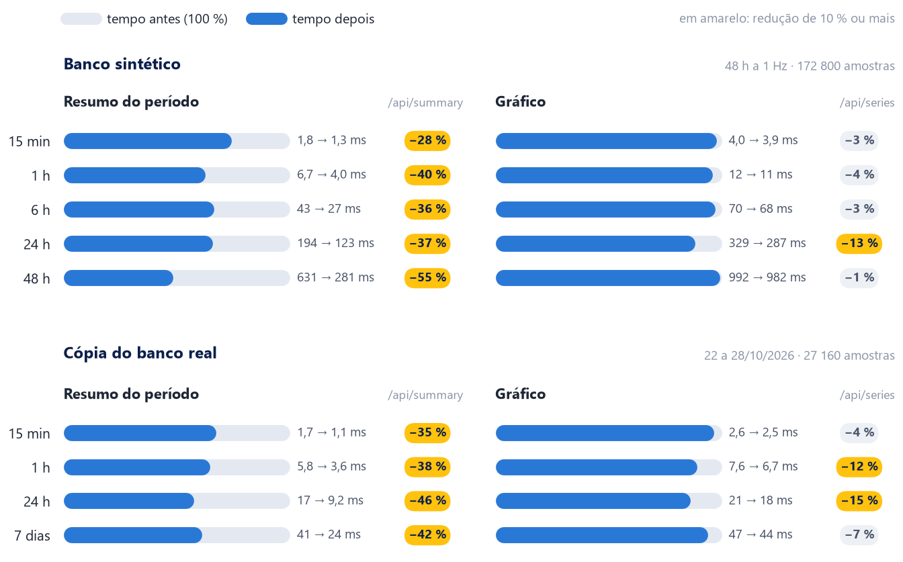

# Otimização do backend: antes × depois (28/10/2026)

Otimizamos o processamento do servidor **sem alterar nenhum cálculo nem funcionalidade**:

| Rota | Resultado |
|---|---|
| Resumo do período (`/api/summary`) | **28 % a 55 % mais rápido** (janela de 24 h: 194 → 123 ms; 48 h: 631 → 281 ms) |
| Gráfico (`/api/series`) | 1 % a 15 % mais rápido |
| Histórico (`/api/history`) | igual (não foi alterado) |
| Leitura das 4 tabelas do datalogger | opção de leitura em paralelo pronta, **desligada** até ser medida com o CR1000Xe real |
| Cálculos | **69 de 69 respostas idênticas byte a byte** às do código anterior; 221 testes passando |



*Tempo de processamento no servidor por chamada (mediana). A barra cinza é o tempo antes (100 %) e a azul, o tempo depois; à
direita, os tempos em ms e a redução. Na janela padrão do painel (15 min) tudo já levava poucos milissegundos: o ganho aparece nas
janelas longas.*

## Ponto de partida (medido antes de mexer)

| O que | Valor | Como |
|---|---|---|
| CPU do servidor só adquirindo (1 leitura por segundo) | 0,15 % de um núcleo | processo real por 30 s, emulador, banco de 48 h |
| Ciclo de leitura do CR1000Xe (4 tabelas, uma depois da outra) | ~240 ms (p50), ~275 ms (p95) | linha `resumo:` do `logs/servidor.log` real, 28/10 |
| Rotas da tela na janela padrão (15 min) | 1–4 ms | tabelas abaixo |
| Rotas em janelas longas (24–48 h) | 0,2–1 s | tabelas abaixo |

Na aquisição e no uso normal não havia o que ganhar. O custo estava nas janelas longas do painel e no tempo que o datalogger leva
para responder as 4 tabelas.

## O que mudou no código

### 1. Cobertura do período calculada uma vez (`calc.py`)

O resumo e o resultado dos ensaios usam `precip_period`, que percorria todas as amostras do período **duas vezes** para achar os
trechos cobertos. No perfil (`cProfile`) da janela de 24 h, isso era 64 % do tempo do resumo.

Antes:

```python
n = count_in(tip_ts, start, end)
cov, gaps, complete = window_coverage(sample_ts, start, end)            # 1ª passada pelas amostras
...
    n_cov = sum(count_in(tip_ts, a, b) for a, b in covered_intervals(sample_ts, start, end))   # 2ª passada
```

Depois:

```python
n = count_in(tip_ts, start, end)
iv = covered_intervals(sample_ts, start, end)   # uma passada só: cobertura e basculadas cobertas usam os mesmos trechos
cov, gaps, complete = _coverage(iv, start, end)
...
    n_cov = sum(count_in(tip_ts, a, b) for a, b in iv)
```

Dentro de `covered_intervals`, o laço também deixou de criar uma tupla nova a cada amostra:

```python
# antes: a cada amostra que estende o trecho, uma tupla nova
if out and a <= out[-1][1]:
    out[-1] = (out[-1][0], max(out[-1][1], b))

# depois: o trecho aberto fica em duas variáveis e só vira tupla quando fecha
if a is not None and t <= b:
    if e > b:
        b = e
else:
    if a is not None:
        out.append((a, b))
    a, b = t, e
```

Os trechos são os mesmos, em inteiros (ms), então o resultado é idêntico.

### 2. Gráfico: configuração montada uma vez e valores repetidos reaproveitados (`app.py`, `/api/series`)

Antes, cada linha chamava `flow_value(..., cfg)`, que remontava a configuração do medidor (`flow_cfg`) a cada chamada: 86 mil vezes
numa janela de 24 h.

```python
# antes
fl = [flow_value(r[5], r[3], r[6], r[4], cfg)[0] for r in rows]

# depois
fc, memo, fl = flow_cfg(cfg), {}, []
for r in rows:   # a vazão só depende do método, do canal que ele usa e do estado
    x = r[6] if r[5] == "pulse" else r[3]
    if not x:    # None, 0,0 ou -0,0: calcula direto (0,0 e -0,0 seriam a mesma chave)
        fl.append(flow_value(r[5], r[3], r[6], r[4], fc=fc)[0])
        continue
    key = (r[5], x, r[4])
    fv = memo.get(key, memo)
    if fv is memo:
        fv = memo[key] = flow_value(r[5], r[3], r[6], r[4], fc=fc)[0]
    fl.append(fv)
```

A função de cálculo é a mesma, com a mesma entrada, então o resultado é o mesmo. A média de cada bloco do gráfico passou a usar
fatias da lista (`v[i:j]`) em vez de índices, com a mesma soma na mesma ordem. O ganho é pequeno (1 a 15 %): o resto do tempo é ler
as linhas do SQLite e montar as listas, o que não dá para reduzir sem mudar o jeito de calcular.

### 3. Histórico e exportação CSV (`app.py`)

A configuração do medidor também passou a ser montada uma vez por requisição (a exportação pode ter até 200 mil linhas). Não medido
separadamente.

### 4. Leitura das tabelas em paralelo (`datalogger.py`, opcional e desligada)

Ver a seção própria abaixo.

## Antes × depois em números

Tempo por chamada, em ms. Mediana de 9 chamadas em cada uma de 3 rodadas, alternando código anterior e novo, dentro do processo
(sem rede). "Antes" = código do pacote de entrega da manhã de 28/10; "depois" = código atual. Mesma máquina, mesmos bancos.

**Banco sintético**, 48 h a 1 Hz (172 800 amostras, 17 280 basculadas), gerado só para a medição numa pasta temporária:

| Janela | Resumo | Gráfico | Histórico |
|---|---|---|---|
| 15 min | 1,8 → 1,3 (−28 %) | 4,0 → 3,9 (−3 %) | 1,1 → 1,0 |
| 1 h | 6,7 → 4,0 (−40 %) | 11,8 → 11,3 (−4 %) | 2,4 → 2,3 |
| 6 h | 43,0 → 27,4 (−36 %) | 69,9 → 67,8 (−3 %) | 14,4 → 13,3 |
| 24 h | 193,9 → 122,7 (−37 %) | 328,7 → 286,8 (−13 %) | 75,7 → 74,5 |
| 48 h | 631,3 → 281,0 (−55 %) | 991,9 → 982,3 (−1 %) | 240,1 → 261,8 |

**Cópia do banco real** (27 160 amostras de 22 a 28/10, com lacunas):

| Janela | Resumo | Gráfico | Histórico |
|---|---|---|---|
| 15 min | 1,7 → 1,1 (−35 %) | 2,6 → 2,5 (−4 %) | 1,0 → 1,0 |
| 1 h | 5,8 → 3,6 (−38 %) | 7,6 → 6,7 (−12 %) | 1,8 → 1,8 |
| 24 h | 16,9 → 9,2 (−46 %) | 20,8 → 17,7 (−15 %) | 3,7 → 3,9 |
| tudo (7 dias) | 40,9 → 23,8 (−42 %) | 47,4 → 44,3 (−7 %) | 8,8 → 9,0 |

O histórico não foi alterado: as diferenças nele (até ±10 %) são o ruído da medição.

## Testado e descartado

- **Estatísticas do período numa passada só.** Juntar as 4 consultas de média/mínimo/máximo numa só, com `CASE`, deixou o histórico
  27 % a 71 % **mais lento**: o SQLite avalia as 11 condições em cada linha, e as 4 varreduras separadas eram baratas. Revertido;
  esse trecho voltou a ser exatamente o código anterior.

## Não recomendado

- `PRAGMA synchronous=NORMAL`: ganho irrelevante (uma gravação por segundo) e, numa queda de energia, pode perder a última gravação
  com o cursor do datalogger já avançado, ou seja, perder o dado de vez.
- Calcular a média do gráfico no SQL: a soma muda de algoritmo e de ordem e pode alterar a 3ª casa decimal.
- Juntar as 4 tabelas em uma no CRBasic: seria o maior ganho na leitura (1 consulta por segundo em vez de 4), mas muda o programa do
  datalogger e o perfil.

## Prova de que nenhum cálculo mudou

- **Respostas idênticas byte a byte.** 69 respostas gravadas com o código anterior (extraído do pacote de entrega) e comparadas com o
  novo: resumo, gráfico, basculadas e histórico (com e sem filtro de estado) em 5 janelas, exportação CSV de amostras e de eventos,
  lista de ensaios e o resultado de cada um dos 3 ensaios do banco real. Foram 36 respostas na cópia do banco real e 33 no sintético:
  **69 de 69 idênticas**. Só ficaram fora da comparação os campos de estado ao vivo do resumo (relógio, comunicação, método), que não
  são cálculo.
- **Testes.** `pytest tests`: 221 passaram (eram 159). Os 62 novos comparam a cobertura e a precipitação com uma cópia do algoritmo
  anterior em 60 cenários aleatórios (lacunas, horários repetidos e fora de ordem), conferem linha a linha que o gráfico dá o mesmo
  que `flow_value` (valor repetido, canal que o método não usa, zero com e sem sinal, ausente, fora da faixa) e que a leitura
  paralela entrega o mesmo que a sequencial.
- **Ponta a ponta.** `e2e_ensaio` 36 ok, `e2e_programa_atual` 17 ok, `e2e_cr1000x_elus_calib` 16 ok e `e2e_ensaio` com
  `DATALOGGER_PARALLEL=1` 36 ok.

## Leitura das tabelas em paralelo (opcional, desligada)

Hoje o servidor lê as 4 tabelas uma depois da outra: ~240 ms por ciclo no datalogger real, quase tudo tempo de resposta do CR1000Xe
(HTTP simples, ~60 ms por tabela). Em paralelo, o número de consultas por segundo é o mesmo. Se o CR1000Xe atender requisições
simultâneas, o ciclo cai para perto do tempo da tabela mais lenta, e a latência do tempo real cai junto. Se ele atender uma de cada
vez, não há ganho (nem prejuízo). Os contadores de diagnóstico compartilhados entre as tabelas (lacunas e reinícios) ganharam uma
trava; o resto do estado é de cada tabela.

Como medir (desenvolvedor, com o datalogger real, só leitura):

1. Anote a linha `resumo:` do log com o servidor normal: `consulta p50=… p95=… ms` e `erros=…`.
2. `parar.bat`; defina `DATALOGGER_PARALLEL=1` (variável de ambiente do usuário, ou `set DATALOGGER_PARALLEL=1` no `iniciar.bat`
   antes de subir o Python); `iniciar.bat`. O log mostra `Leitura das tabelas do datalogger em paralelo`.
3. Depois de 10 a 15 min, compare `consulta p50/p95` e `erros` na linha `resumo:` e `lat_ms` em `/api/diag`.
4. Se não melhorar, ou se aparecerem erros de comunicação, remova a variável e reinicie: volta ao modo sequencial.

Testado só com o emulador (36 ok de ponta a ponta e o teste de equivalência). **Não foi medido no CR1000Xe.**

## Como as medições foram feitas

- Instância isolada do servidor (o `app.py` de verdade) com o emulador do CR1000Xe e os bancos numa pasta temporária. O banco, o
  cursor e o `config.json` reais não foram tocados; o banco real entrou só como cópia.
- Tempos por rota: chamadas pelo `test_client` do Flask dentro do processo (sem rede e sem a thread de aquisição), com o código
  anterior e o atual alternados em 3 rodadas.
- Perfil (`cProfile`) da janela de 24 h para achar onde o tempo ia: no resumo, 64 % era a cobertura do período calculada duas vezes;
  no gráfico, cerca de 40 % era a conversão linha a linha com a configuração remontada.
- CPU: tempo de processador do processo real do servidor (filho do lançador do `.venv`) durante 30 s só adquirindo.
- Gráfico desta página: a barra azul é a fração do tempo que sobrou depois da otimização, e a redução também aparece escrita, então a
  leitura não depende de distinguir cores.
